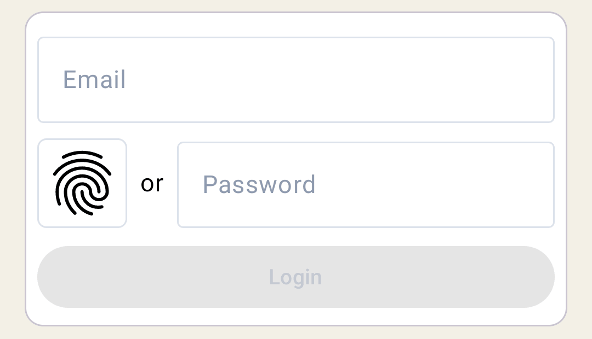
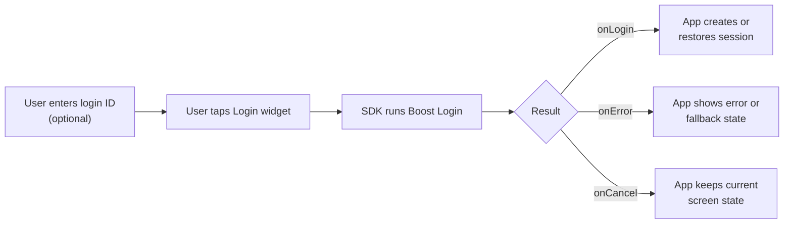
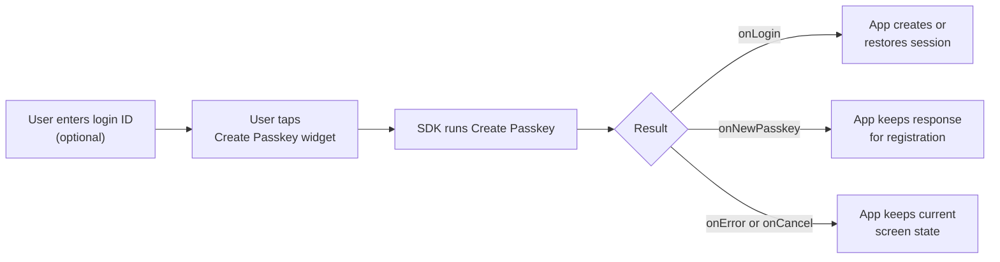

# Boost Flow

Boost Flow adds OwnID to an existing native login or account-creation form. The user stays in your app UI, taps an OwnID widget, and the SDK runs the recommended authentication or create-passkey path for that entry point.

Use Boost when the app keeps its current password login or registration form and adds OwnID as the passkey-first path next to it.

<picture>
  <source media="(prefers-color-scheme: dark)" srcset="../images/android-boost-login-dark.png">
  <source media="(prefers-color-scheme: light)" srcset="../images/android-boost-login-light.png">
  
</picture>

## Contents

- [Minimal Integration](#minimal-integration)
- [Examples](#examples)
- [Prerequisites](#prerequisites)
- [Flow Shape](#flow-shape)
- [Integration Details](#integration-details)
- [Widget Callbacks](#widget-callbacks)
- [Customization](#customization)
- [Security and Data Handling](#security-and-data-handling)

## Minimal Integration

### Login Widget Integration

Add [`OwnIdLoginWidget`](../../sdk-compose/compose/src/main/java/com/ownid/sdk/compose/widget/OwnIdLoginWidget.kt) next to the app's password field. Pass the same login ID value that the user edits in the form, then handle `onLogin`, `onError`, and `onCancel`.

```kotlin
import com.ownid.sdk.compose.widget.OwnIdLoginWidget
import com.ownid.sdk.flow.boost.BoostFlow

@Composable
fun LoginScreen(
    onPasswordLogin: (email: String, password: String) -> Unit,
    onOwnIdLogin: (BoostFlow.Response.Login) -> Unit
) {
    var email by rememberSaveable { mutableStateOf("") }
    var password by rememberSaveable { mutableStateOf("") }

    Column {
        OutlinedTextField(
            value = email,
            onValueChange = { email = it },
            label = { Text("Email") },
            singleLine = true
        )

        Row {
            OwnIdLoginWidget(
                onLogin = { response ->
                    email = response.loginId.id
                    onOwnIdLogin(response)
                },
                loginId = email,
                onError = {
                    // Show an app-owned error or fallback state and keep password login available.
                },
                onCancel = {
                    // Keep the user on the login screen.
                }
            )

            OutlinedTextField(
                value = password,
                onValueChange = { password = it },
                label = { Text("Password") },
                visualTransformation = PasswordVisualTransformation()
            )
        }

        Button(onClick = { onPasswordLogin(email, password) }) {
            Text("Login")
        }
    }
}
```

### Create-Passkey Widget Integration

Add [`OwnIdCreatePasskeyWidget`](../../sdk-compose/compose/src/main/java/com/ownid/sdk/compose/widget/OwnIdCreatePasskeyWidget.kt) to the registration form. Store the create-passkey response for registration submission.

```kotlin
import com.ownid.sdk.compose.widget.OwnIdCreatePasskeyWidget
import com.ownid.sdk.flow.boost.BoostFlow
import com.ownid.sdk.flow.boost.ownIdDataFor

@Composable
fun RegisterScreen(
    registerUser: (name: String, email: String, password: String, ownIdData: String?) -> Unit,
    onOwnIdLogin: (BoostFlow.Response.Login) -> Unit
) {
    var name by rememberSaveable { mutableStateOf("") }
    var email by rememberSaveable { mutableStateOf("") }
    var password by rememberSaveable { mutableStateOf("") }
    var createPasskeyResponse by remember { mutableStateOf<BoostFlow.Response.CreatePasskey?>(null) }

    val ownIdData = createPasskeyResponse?.ownIdDataFor(currentLoginId = email)

    Column {
        OutlinedTextField(value = name, onValueChange = { name = it }, label = { Text("Name") })
        OutlinedTextField(value = email, onValueChange = { email = it }, label = { Text("Email") })

        Row {
            OwnIdCreatePasskeyWidget(
                onLogin = { response ->
                    email = response.loginId.id
                    onOwnIdLogin(response)
                },
                onNewPasskey = { response ->
                    email = response.loginId.id
                    // Keep this response for submit. Read ownIdData with the current form login ID.
                    createPasskeyResponse = response
                },
                onReset = {
                    // The widget cleared its completed create-passkey state, for example after the form login ID
                    // no longer matches the saved response. Discard saved create-passkey data.
                    createPasskeyResponse = null
                },
                loginId = email,
                onError = {
                    // Show an app-owned error or fallback state and keep manual registration available.
                },
                onCancel = {
                    // Keep the current account-creation UI state.
                }
            )

            OutlinedTextField(
                value = password,
                onValueChange = { password = it },
                label = { Text("Password") },
                visualTransformation = PasswordVisualTransformation()
            )
        }

        Button(onClick = { registerUser(name, email, password, ownIdData) }) {
            Text("Submit")
        }
    }
}
```

## Examples

- [Base login widget example](../../demoBase/app/src/main/java/com/ownid/demo/boost/BoostLoginTab.kt)
- [Base create-passkey widget example](../../demoBase/app/src/main/java/com/ownid/demo/boost/BoostCreatePasskeyTab.kt)
- [Advanced login widget example](../../demoAdvanced/app/src/main/java/com/ownid/demo/flow/boost/BoostLoginScreen.kt)
- [Advanced create-passkey widget example](../../demoAdvanced/app/src/main/java/com/ownid/demo/flow/boost/BoostCreatePasskeyScreen.kt)

## Prerequisites

- Add the Compose UI SDK as described in [Install](../../README.md#install), initialize OwnID in [Configuration](../setup/configuration.md), and complete platform passkey setup in [Passkey Setup](../setup/passkeys.md).
- Register [`sessionCreate`](../setup/providers.md#session-create) if Boost login should return an app-defined session as `response.session`. Without an available provider, `onLogin` still receives `accessToken` and `sessionPayload`.
- Keep the existing password login available next to the OwnID widget. Keep manual registration as the fallback when no matching `ownIdData` is available.

## Flow Shape

### Login Flow Shape



### Create-Passkey Flow Shape



## Integration Details

Use these rules when wiring app state to Boost callbacks:

- **Login ID input:** Pass the same email, phone, or username value that the user edits in your form. The widget ignores blank values.
- **Returned login ID:** When `onLogin` or `onNewPasskey` returns, update the form from the response login ID because OwnID may normalize or resolve the value during the flow.
- **Password fallback:** Keep the app's password login available. For registration, use the normal manual path when the user cancels, OwnID cannot complete, or no matching `ownIdData` is available.
- **Create-passkey data:** Store the create-passkey response for registration submit. Read `ownIdData` with `ownIdDataFor(currentLoginId = ...)` so it is used only for the current form value. When it returns non-null `ownIdData`, do not ask for, validate, or require a user-entered password. Submit `ownIdData` unchanged with the registration request. Whether the identity system creates a passwordless account, generates an internal password, or uses another supported mechanism is determined by the app's backend business logic.
- **Changed form value:** If the user changes the email, phone, or username after `onNewPasskey`, clear the stored create-passkey response or ignore it until the login ID matches again. The widget calls `onReset` when it clears completed create-passkey state, including after the form login ID stops matching the saved response.
- **No-proof result:** `onNewPasskey` can return without `ownIdData` when passkey creation is unavailable or fails. Continue with normal registration and do not submit OwnID proof data.

## Widget Callbacks

### Login Widget

- `onLogin`: Called when Boost login completes successfully. It receives [`BoostFlow.Response.Login`](../../sdk-core/core/src/main/java/com/ownid/sdk/flow/boost/BoostFlow.kt) with these fields:

  - `loginId`: Update the visible form value if the SDK resolved or normalized the login ID.
  - `authMethod`: Record or branch on the completed authentication method, such as passkey or OTP, when the app needs it.
  - `accessToken`: [OwnID Access Token](../setup/access-token.md) for app session handoff when needed.
  - `sessionPayload`: Server-provided payload for app session integration; also passed to [`sessionCreate`](../setup/providers.md#session-create) when that provider is available.
  - `session`: App-defined value returned by [`sessionCreate`](../setup/providers.md#session-create); `null` when the provider is not configured or unavailable.

- `onError`: Called when Boost login fails. It receives [`BoostLoginFlowFailure`](../../sdk-core/core/src/main/java/com/ownid/sdk/flow/boost/BoostFlow.kt); branch on the concrete failure type for routing decisions, show app-owned retry or fallback UI, and keep password login available.
- `onCancel`: Called when the user closed the flow or the flow was canceled. It receives a `Reason`; keep the user on the same screen unless the app has a better fallback for that reason.

### Create-Passkey Widget

- `onLogin`: Called when OwnID recognizes and authenticates an existing user instead of creating a new account. It receives `BoostFlow.Response.Login`; see [Login Widget](#login-widget) for response fields.

The create-passkey widget can also complete successfully with a create-passkey response:

- `onNewPasskey`: Called when the widget has a create-passkey response. Edits made while the flow is running do not retarget that flow and do not cause an intermediate `onReset`. The callback receives [`BoostFlow.Response.CreatePasskey`](../../sdk-core/core/src/main/java/com/ownid/sdk/flow/boost/BoostFlow.kt) with these fields:

  - `loginId`: Update the registration form and validate it before submit.
  - `proofToken`: Proof Token produced by passkey-related operations, or `null` when no proof is available.
  - `ownIdData`: Submit with the registration request when `ownIdDataFor(currentLoginId = ...)` returns it. Do not modify it.

- `onReset`: Called when the widget clears its completed create-passkey state, including after the form login ID stops matching the saved response. Clear the stored create-passkey response.
- `onError`: Called when the create-passkey flow fails. It receives [`BoostCreatePasskeyFlowFailure`](../../sdk-core/core/src/main/java/com/ownid/sdk/flow/boost/BoostFlow.kt); branch on the concrete failure type for routing decisions, show app-owned retry or fallback UI, and keep manual registration available.
- `onCancel`: Called when the user closed the flow or the flow was canceled. It receives a `Reason`; keep the user on the same screen unless the app has a better fallback for that reason.

### Common Failures

| Failure | What it usually means | Recommended handling |
| --- | --- | --- |
| `Input.UnresolvedLoginId` | Boost could not resolve a usable login ID from the form value, current context, or Access Token. | Let the user enter or correct the identifier and start a new Boost attempt. If the flow used an Access Token or context value, check that the supplied data contains a valid login ID. |
| `Account.Blocked` | The resolved account is blocked and cannot continue through this OwnID path. | Route the user to the app's blocked-account, recovery, or support path. Treat this as an expected account-state result, not as a retryable SDK failure. |
| `Account.NotFound` | This path expected an existing account, but none was found for the resolved login ID. | Route according to the screen: registration, another identifier entry path, or the app's normal account-not-found handling. Treat this as an expected account-state result. |
| `InsufficientAuth` | Boost could not complete authentication with the available operations. | Offer another app-level sign-in or registration path, or let the user start a new attempt later. If the login uses `allowedAuthOperations`, check that it allows the authentication categories intended for this entry point. |
| `OperationFailed` | A required SDK operation could not start, was unavailable, or failed while the flow was running. | End the current attempt and offer retry or another app-level path. Use `operationType`, nested `operationFailure`, and diagnostics to understand which SDK operation failed. |
| `SessionCreationFailed` | OwnID authentication completed, but the app's `sessionCreate` provider failed. | Show an app session/sign-in failure state and inspect the [`sessionCreate`](../setup/providers.md#session-create) provider. Do not treat this as failed OwnID authentication. |
| `Unexpected` | The flow hit an unexpected SDK, runtime, or integration state. | Show a generic failure or retry state. Log diagnostics and retry only by starting a new Boost attempt. |

Use the failure's `errorCode` as a localization key when showing OwnID-related copy. Treat `message` and nested errors as diagnostics, not end-user text.

## Customization

### Customize the Default Widgets

The default widgets support theme, strings, showing OwnID before or after the `or` separator, icon button, checkmark, spinner, and separator text customization.

- For theme and palette setup, see [Themes and Colors](../customization/themes-and-colors.md).
- For SDK language setup, see [Configuration](../setup/configuration.md#language).
- For widget copy, see [Localization](../customization/localization.md).
- For deeper widget customization, see [Boost Widget Customization](../customization/boost-widgets.md).

### Use Your Own UI

If the standard widget does not fit your UI, render your own button or control and let a lifecycle-aware `ViewModel` start and observe the Boost flow.

Default widgets bind each new flow to their host `Activity` automatically. A custom flow starter can bind a known `Activity` with `OwnId.flows.withProviders { uiContext(activity) }`. A flow started through `OwnId.flows` without a scoped override uses the current top-level UI-context provider. See [UI Context](../setup/providers.md#ui-context).

#### Login

```kotlin
Button(
    enabled = email.isNotEmpty() && !viewModel.isRunning,
    onClick = { viewModel.startLogin(email) }
) {
    Text(if (viewModel.isRunning) "Running…" else "Continue with OwnID")
}
```

Start the flow in `viewModelScope`, keep its controller until `whenSettled()` returns, and register it for cleanup when the `ViewModel` is cleared:

```kotlin
class CustomBoostViewModel : ViewModel() {
    var isRunning by mutableStateOf(false)
        private set

    fun startLogin(loginId: String) {
        if (isRunning) return

        viewModelScope.launch {
            isRunning = true

            try {
                val context = BoostFlowContext {
                    loginId(loginId)
                }
                val result = try {
                    val controller = OwnId.flows.boost.login.start(context)
                        .also { addCloseable("custom_boost_login", it) }
                    controller.whenSettled()
                } catch (error: CancellationException) {
                    throw error
                } catch (error: Exception) {
                    FlowResult.Failure(
                        BoostLoginFlowFailure.Unexpected(
                            errorCode = ErrorCode.IntegrationError,
                            message = error.message ?: "Failed to start login flow",
                            error = error
                        )
                    )
                }

                result
                    .onSuccess { response ->
                        // Use response to update the app session, then publish the next UI state or effect.
                    }
                    .onCanceled { reason ->
                        // Use reason to publish the app state appropriate for cancellation.
                    }
                    .onError { failure ->
                        // Use failure to publish app-owned error or fallback state.
                    }
            } finally {
                isRunning = false
            }
        }
    }
}
```

#### Create Passkey

```kotlin
Button(
    enabled = email.isNotEmpty() && !viewModel.isRunning,
    onClick = { viewModel.startCreatePasskey(email) }
) {
    Text(if (viewModel.isRunning) "Running…" else "Create a passkey")
}
```

The create-passkey flow uses the same controller ownership pattern. Its ViewModel handles both possible success values:

```kotlin
class CustomCreatePasskeyViewModel : ViewModel() {
    var isRunning by mutableStateOf(false)
        private set

    fun startCreatePasskey(loginId: String) {
        if (isRunning) return

        viewModelScope.launch {
            isRunning = true

            try {
                val context = BoostFlowContext {
                    loginId(loginId)
                }
                val result = try {
                    val controller = OwnId.flows.boost.createPasskey.start(context)
                        .also { addCloseable("custom_boost_create_passkey", it) }
                    controller.whenSettled()
                } catch (error: CancellationException) {
                    throw error
                } catch (error: Exception) {
                    FlowResult.Failure(
                        BoostCreatePasskeyFlowFailure.Unexpected(
                            errorCode = ErrorCode.IntegrationError,
                            message = error.message ?: "Failed to start create-passkey flow",
                            error = error
                        )
                    )
                }

                result
                    .onSuccess { response ->
                        when (response) {
                            is BoostFlow.Response.Login -> {
                                // Use response to update the app session, then publish the next UI state or effect.
                            }

                            is BoostFlow.Response.CreatePasskey -> {
                                // Keep response for registration and publish the next UI state or effect.
                            }
                        }
                    }
                    .onCanceled { reason ->
                        // Use reason to publish the app state appropriate for cancellation.
                    }
                    .onError { failure ->
                        // Use failure to publish app-owned error or fallback state.
                    }
            } finally {
                isRunning = false
            }
        }
    }
}
```

See [Widget Callbacks](#widget-callbacks) and [Common Failures](#common-failures) for response and failure handling. The [Advanced custom login button](../../demoAdvanced/app/src/main/java/com/ownid/demo/flow/boost/BoostLoginScreen.kt) and its [ViewModel](../../demoAdvanced/app/src/main/java/com/ownid/demo/flow/boost/EmailOtpLoginViewModel.kt) show the complete integration.

### Limit Login Authentication Operations

An app-owned login entry point can represent a specific authentication choice, such as **Login via email OTP**. Set `allowedAuthOperations` for that Boost Login run to allow only the categories that match the entry point.

```kotlin
val context = BoostFlowContext {
    loginId(email, LoginId.Type.Email)
    allowedAuthOperations = setOf(
        BoostLoginAuthOperation.EMAIL_VERIFICATION
    )
}
```

Pass this context to the Boost Login start call shown above. This option is available only for Boost Login. The available categories are `PASSKEY`, `EMAIL_VERIFICATION`, and `PHONE_NUMBER_VERIFICATION`.

`PASSKEY` allows passkey sign-in and passkey creation when that path is offered during login. Leaving `allowedAuthOperations` unset or empty preserves the usual Boost Login behavior. If the login cannot complete with the allowed categories, it returns `InsufficientAuth`.

## Security and Data Handling

- Treat `accessToken`, `sessionPayload`, and `ownIdData` as sensitive handoff values.
- Do not log passwords, provider tokens, OwnID Access Tokens, session payloads, or full authentication responses.
- Keep password login and manual registration available unless the product explicitly removes those fallbacks.
