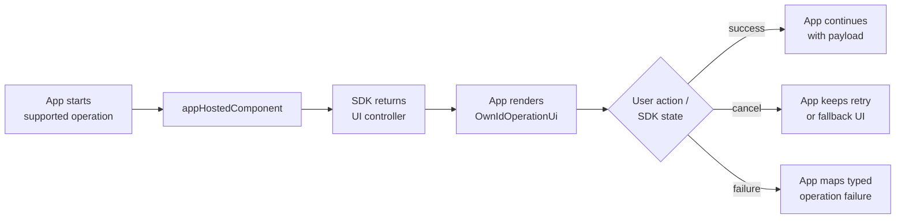

# App-Hosted Operation UI

Use app-hosted operation UI when the app owns where a supported OwnID operation appears, but still wants the SDK to drive operation state, validation, resend, cancellation, and settlement.

This applies to login ID collection, email verification, and phone verification. If the SDK should present its default UI container, start the operation directly without [`appHostedComponent`](../../sdk-compose/compose/src/main/java/com/ownid/sdk/compose/OwnIdOperationUiHosting.kt).

## Contents

- [Minimal Integration](#minimal-integration)
- [Examples](#examples)
- [Prerequisites](#prerequisites)
- [Operation UI Lifecycle](#operation-ui-lifecycle)
- [App-Owned Presentation](#app-owned-presentation)
- [Custom Content](#custom-content)
- [UI Error Text](#ui-error-text)

## Minimal Integration

Choose the operation, apply `appHostedComponent`, keep the returned [`OwnIdOperationUiController`](../../sdk-compose/compose/src/main/java/com/ownid/sdk/compose/OwnIdOperationUiHosting.kt) in UI state, render [`OwnIdOperationUi`](../../sdk-compose/compose/src/main/java/com/ownid/sdk/compose/OwnIdOperationUi.kt), and await settlement. In the example below, `operations` is the scoped operation namespace for the current integration context.

Availability is a preflight signal only. Use it to hide or disable unavailable actions, but still handle cancellation and typed failures from the started operation.

If the owner stops awaiting before settlement, keep rendering the controller or explicitly abort or close the operation during cleanup.

```kotlin
import com.ownid.sdk.compose.OwnIdOperationUi
import com.ownid.sdk.compose.OwnIdOperationUiController
import com.ownid.sdk.compose.start
import com.ownid.sdk.compose.appHostedComponent
import com.ownid.sdk.model.Authz
import com.ownid.sdk.model.LoginId
import com.ownid.sdk.ops.onCanceled
import com.ownid.sdk.ops.onError
import com.ownid.sdk.ops.onSuccess

var currentOperationUiController by mutableStateOf<OwnIdOperationUiController<*, *>?>(null)

viewModelScope.launch {
    val scopedOperations = operations.withContext {
        authz = Authz.start(email, LoginId.Type.Email)
    }

    val emailVerificationOperation = scopedOperations.verifications.email
        // Makes this operation app-hosted: the SDK runs it, and the app renders it with OwnIdOperationUi.
        .appHostedComponent

    if (!emailVerificationOperation.isAvailable()) {
        // Hide or disable this action for the current context.
        return@launch
    }

    val startedOperationUiController = emailVerificationOperation.start()
    currentOperationUiController = startedOperationUiController

    startedOperationUiController.whenSettled()
        .onSuccess { token ->
            // Continue with the Access Token or Proof Token.
        }
        .onCanceled { reason ->
            // Handle user close, timeout, or system cancellation.
        }
        .onError { error ->
            // Map the operation failure to app UI or diagnostics.
        }

    if (currentOperationUiController == startedOperationUiController) {
        currentOperationUiController = null
    }
}
```

Render the operation UI controller while it is active.

```kotlin
currentOperationUiController?.let { operationUiController ->
    OwnIdOperationUi(operationUiController = operationUiController)
}
```

## Examples

- [Login ID collect operation screen](../../demoAdvanced/app/src/main/java/com/ownid/demo/ops/OperationLoginIdCollectScreen.kt)
- [Verification operation screen](../../demoAdvanced/app/src/main/java/com/ownid/demo/ops/OperationVerificationScreen.kt)
- [Operation dialog wrapper](../../demoAdvanced/app/src/main/java/com/ownid/demo/ops/DemoOperationDialog.kt)

## Prerequisites

- Add the Compose UI SDK as described in [Install](../../README.md#install) and initialize OwnID in [Configuration](../setup/configuration.md).
- Scope each operation attempt with the login ID, Access Token, or other values that operation needs; see [Context](../setup/context.md) and [Namespace Handles](../setup/namespace-handles.md).
- Build the app-owned Compose container for embedded, dialog, sheet, or overlay presentation and keep the operation UI controller in UI state until `whenSettled()` completes.
- Keep app authentication, session, retry, or fallback UI available for unavailable, canceled, or failed operation attempts.

## Operation UI Lifecycle



## App-Owned Presentation

App-hosted UI owns where the SDK operation UI is rendered. The SDK still owns operation state and settlement. Invoke callbacks from the SDK-provided UI state and do not complete, resend, or cancel through private implementation details.

Supported app-hosted operation UI:

- Login ID collection: `operations.loginId.collect.appHostedComponent`
- Email verification: `operations.verifications.email.appHostedComponent`
- Phone verification: `operations.verifications.phone.appHostedComponent`

Both presentation patterns below require starting the operation through `appHostedComponent`. The difference is only where the returned `OwnIdOperationUiController` is rendered.

### Embedded

After starting with `appHostedComponent`, render `OwnIdOperationUi` directly inside the screen. Removing it from composition aborts an unsettled operation with user-close semantics.

```kotlin
currentOperationUiController?.let { operationUiController ->
    OutlinedCard {
        OwnIdOperationUi(
            operationUiController = operationUiController
        )
    }
}
```

### Dialog, Sheet, or Overlay

After starting with `appHostedComponent`, use [`OwnIdUiContainerController`](../../sdk-compose/compose/src/main/java/com/ownid/sdk/compose/OwnIdUiContainerController.kt) when the operation UI is inside an app-owned dialog, bottom sheet, or overlay.

Keep the started `OwnIdOperationUiController` in UI state until `whenSettled()` returns, then clear it and start a new operation entry for retry. Create a new `OwnIdUiContainerController` for each presentation cycle, keep the same instance until that container is fully dismissed, and discard it after `markClosed()`.

Call `markOpened()` when the container is visible and ready for input. Call `markClosed()` when it is fully dismissed. Removing `OwnIdOperationUi` from composition is not a substitute for `markClosed()` in container mode; report the actual dialog, sheet, or overlay close event.

If the UI stops owning an unsettled operation without rendering `OwnIdOperationUi` or without reporting the app-owned container close, call `operationUiController.abort(reason)` with a meaningful `Reason` or `operationUiController.close()` for owner-driven cleanup.

```kotlin
import com.ownid.sdk.compose.OwnIdOperationUi
import com.ownid.sdk.compose.OwnIdOperationUiController
import com.ownid.sdk.compose.OwnIdUiContainerController

@Composable
fun VerificationDialog(
    operationUiController: OwnIdOperationUiController<*, *>
) {
    // Keep dialog visibility tied to this SDK operation. A new operation gets
    // a new operationId and therefore a fresh dialog/container lifecycle.
    var isVisible by retain(operationUiController.operationId, "isVisible") {
        mutableStateOf(true)
    }

    // OwnIdUiContainerController is single-use. Keep it for this presentation
    // cycle and create a new one for another operation UI controller.
    val containerController = retain(operationUiController.operationId, "containerController") {
        OwnIdUiContainerController(
            closeAction = {
                isVisible = false
            }
        )
    }

    if (!isVisible) return

    RetainedEffect(containerController) {
        containerController.markOpened()
        onRetire { containerController.markClosed() }
    }

    BasicAlertDialog(onDismissRequest = containerController::close) {
        Surface {
            OwnIdOperationUi(
                operationUiController = operationUiController,
                uiContainerController = containerController
            )
        }
    }
}
```

## Custom Content

Use custom content when an app-hosted operation should keep SDK-owned operation state and settlement, but render one or more supported screens with app UI. Start the operation with `appHostedComponent` and render the returned `OwnIdOperationUiController` with `OwnIdOperationUi`; content overrides only change the content rendered inside that host.

Custom content owns rendering, focus behavior, visible busy indicators, error display, and wiring user actions to the supplied operation UI state callbacks. The SDK still owns validation, resend/cancel/"not you" handling, timeout, abort, and final settlement.

Supported overrides:

- `loginIdCollectContent` replaces login ID collection content. It should update through `uiState.onLoginIdChange`, submit through `uiState.onContinue`, preserve keyboard and autofill hints from the collectable login ID types, use `strings.error` for login ID validation errors, and use `errorTextProvider` or the current `UiError.localizedMessage` for other display errors.
- `emailVerificationContent` / `phoneVerificationContent` replace verification content. They should use `uiState.challenge` for OTP length, resend policy, and the delivery destination shown to the user (`uiState.challenge.channel.channel`), normalize OTP input to digits, submit through `uiState.onCodeEntered` only when the required length is entered and the operation is not busy, reset challenge-scoped input when `uiState.challenge.challengeId` changes, clear input on visible errors, and invoke resend, cancel, and "not you" only from matching user actions.

```kotlin
import com.ownid.sdk.compose.OwnIdOperationUi

OwnIdOperationUi(
    operationUiController = operationUiController,
    loginIdCollectContent = { uiState, strings, modifier, colors, errorTextProvider, isReadyForInitialFocus ->
        MyLoginIdCollectContent(
            uiState = uiState,
            strings = strings,
            modifier = modifier,
            colors = colors,
            errorTextProvider = errorTextProvider,
            requestInitialFocus = isReadyForInitialFocus
        )
    }
)
```

Each content override receives:

| Parameter | Use |
| --- | --- |
| `uiState` | Render the current operation state and invoke user-action callbacks. |
| `strings` | Use localized SDK strings for labels, messages, and actions; see [Localization](../customization/localization.md). |
| `modifier` | Apply the modifier passed to `OwnIdOperationUi`. |
| `colors` | Use OwnID color tokens from the active `OwnIdTheme`; see [Themes and Colors](../customization/themes-and-colors.md). |
| `errorTextProvider` | Optional mapper from `ErrorCode` to display text. |
| `isReadyForInitialFocus` | Request initial focus only after the container is ready. |

For SDK-wide theme and color customization, see [Themes and Colors](../customization/themes-and-colors.md). For localized UI text customization, see [Localization](../customization/localization.md).

## UI Error Text

Use `errorTextProvider` when SDK-rendered operation content should map OwnID UI errors to app-specific copy. The provider receives an [`ErrorCode`](../../sdk-core/core/src/main/java/com/ownid/sdk/model/ErrorCode.kt), which is a localization key for visible text.

[`UiError`](../../sdk-core/core/src/main/java/com/ownid/sdk/model/UiError.kt) represents text that is already meant to be visible inside the current SDK operation UI state. Show `UiError.localizedMessage` when the SDK default copy fits the screen, or use `errorTextProvider` to map `UiError.errorCode` to app copy. Some recoverable verification errors are shown this way so the user can correct a code or resend without the operation settling.

Do not use visible error text, `OperationFailure.message`, or `ErrorCode` for semantic branching. Semantic handling belongs to the typed result or failure returned by `operationUiController.whenSettled()`.

```kotlin
import com.ownid.sdk.compose.OwnIdOperationUi
import com.ownid.sdk.model.ErrorCode

OwnIdOperationUi(
    operationUiController = operationUiController,
    errorTextProvider = { code ->
        when (code) {
            ErrorCode.Network -> "Check your connection and try again."
            else -> "Something went wrong."
        }
    }
)
```
